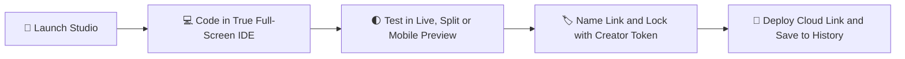

<!-- 🌌 ANIMATED WAVE HEADER BANNER -->
<div align="center">
  

  <!-- ⌨️ LIVE TYPING SVG TEXT ANIMATION -->
  <a href="https://t.me/mk_bots0">
    
  </a>

  <br/>

  <!-- 🛡️ GLOWING ANIMATED SHIELD BADGES -->
  <p align="center">
    
    
    
    
    
  </p>

  <!-- 🎬 ANIMATED CODING GIF SHOWCASE -->
  
</div>

<br/>

<!-- 🌈 ANIMATED RAINBOW DIVIDER -->


## 🌟 Overview

**MK HTML Cloud Studio** is a state-of-the-art, high-performance, browser-based cloud IDE and instant deployment suite designed by **MK_BOTS™**. It empowers developers, creators, and hobbyists to write, debug, preview, and host standalone **HTML, CSS, and JavaScript** applications directly in the cloud with real-time syntax intelligence, custom link naming, creator-locked editing security, local link history tracking, and unlimited project scaling.

---

## 🔥 What's New in v3.0 (Security & History Upgrade)

| Feature | Description | Status |
| :--- | :--- | :---: |
| 📜 **Created Links Local History** | Automatically saves every generated/edited link in your browser's local history with 1-click **Load Code**, **Copy URL**, and **Open** actions. | ✅ **Active** |
| 🏷️ **Custom Permanent Link Naming** | Optionally name your permanent links during creation—automatically appends a clean `&name=your-slug` URL parameter and updates the page title! | ✅ **Active** |
| 🔐 **Creator-Only Edit Protection** | Binds each generated link to a unique cryptographic Creator Token (`mk_creator_uid`). Only the original creator device can edit the link! | ✅ **Active** |
| ⛶ **True 100% Native Full-Screen IDE** | Uses the browser's native Fullscreen API (`requestFullscreen`) alongside the Top Pro Developer Bar & Split-Screen Live Preview. | ✅ **Active** |
| 🧠 **Smart Tag Autocomplete & Linting** | Suggests HTML tags & attributes as you type `<` or press `Ctrl + Space` while highlighting syntax errors in real time. | ✅ **Active** |
| 📦 **Massive Project Support** | Uses **LZ-String Compression + Multi-Bin Automatic Chunking** to deploy projects with **10,000+ lines** effortlessly. | ✅ **Active** |


## 🚀 Core Features

- 🌌 **Immersive VFX Landing Page:** Built with custom interactive particle mesh canvas physics, glassmorphism UI, and dynamic status counters.
- 💻 **Real HTML/CSS/JS IDE & Starter Templates:** Powered by CodeMirror (`material-ocean` theme) with line numbers, active-line glow, auto-formatting, and instant templates (*Basic HTML5, Tailwind CSS, Interactive Canvas Game*).
- ⛶ **True Full-Screen Coding Mode:** Distraction-free native full-screen workspace featuring quick snippet chips (`<div>`, `<style>`, `<script>`, `Flex Box`), font scaling (`A+`/`A-`), code formatting, and side-by-side **🌓 Split Live Preview**.
- 📱 **Responsive Full-Screen Preview Suite:** Switch effortlessly between **💻 Desktop** and **📱 Mobile (375×680)** viewports.
- 🔗 **Named Permanent & Temporary Cloud Links:** Generate time-bound links (in minutes) or permanent password-protected cloud endpoints (`L`) with optional custom link names.
- 🔐 **Creator-Locked Live Link Editing:** Push real-time code updates to existing permanent URLs without changing the link—protected so User B can never overwrite User A's link.
- 🗂️ **Dual Local Storage History:** Tracks both your **📁 Saved Local Files** and your **🔗 Created Links History** (complete with timestamps, `PERM`/`TEMP` badges, and full source code recovery).
- 💎 **Branded Watermark Footer:** Automatically embeds the official **MK_BOTS™** branding and rights notice across all studio previews and deployed cloud viewers.

---

## 🛠️ How It Works



1. **Launch Studio:** Open the live web application and click **🚀 Launch Studio Workspace** from the animated landing page.
2. **Code with Pro Tools:** Write your code with real-time `<tag>` autocomplete, red-line error detection, or enter **⛶ Full Screen Editor** for a 100% native full-screen coding experience.
3. **Test & Inspect:** Click **▶ Run Preview**, toggle **🌓 Split Live Preview**, or open the **🔍 Full Screen Preview Suite** to test mobile and desktop responsiveness.
4. **Deploy & Manage History:** Click **🚀 Generate Link**, choose temporary minutes or type `permanent` (with master password `L`), optionally name your link, and access your link or reload its code anytime from the **🔗 Created Links History** panel!

---

## ⌨️ Pro IDE Keyboard Shortcuts

| Shortcut | Action |
| :---: | :--- |
| `<` or `Ctrl + Space` | Trigger HTML Tag & Attribute Autocomplete |
| `F11` | Toggle True 100% Native Full-Screen Code Editor Mode |
| `Esc` | Exit Native Full-Screen Code Editor Mode |
| `Ctrl + F` / `Cmd + F` | Open Find & Search Bar inside Code Editor |

---

## 📂 File Structure

```text
📦 MK-HTML-Cloud-Studio
 ┣ 📜 index.html       # All-in-one Cloud IDE, Creator-Lock Engine, Link History & Multi-Bin Viewer
 ┗ 📜 README.md        # Animated Project Documentation
```

---

## 🌐 Connect & Follow Us

<div align="center">
  <a href="https://t.me/mk_bots0" target="_blank">
    
  </a>
  <a href="https://youtube.com/@tech_otc_tamil?si=iR8jcUcQG_UMLwYZ" target="_blank">
    
  </a>
  <a href="mailto:OTCTECH3@GMAIL.COM">
    
  </a>
</div>

<br/>

<div align="center">
  <b>ᴘᴏᴡᴇʀᴇᴅ ʙʏ <a href="https://t.me/mk_bots0">ᴍᴋ_ʙᴏᴛs™</a> | ᴀʟʟ ʀɪɢʜᴛs ʀᴇsᴇʀᴠᴇᴅ ♡</b>
</div>

<!-- 🌊 ANIMATED WAVE FOOTER -->

